# 当前手机 UI / UX 现状说明与独立评审包

> 版本快照：2026-11-12，当时工作树（包含当时尚未提交的修改），PWA 静态缓存 v8；现发布于 `review/uiux-current-20261113` 分支。
> 用途：让另一个网页对话 AI 看懂真实现状，并独立提出改进建议；这不是新设计稿，也不是“已经验收通过”的声明。

## 先读：你拿到什么

- [UIUX-STANDALONE.pdf](UIUX-STANDALONE.pdf)：独立图文版，21 张真实浏览器截图，每张注明场景与证据边界。
- `README.md` 与 `images/`：可检索的 Markdown 与原始 PNG；图片路径为相对路径。
- `AI-REVIEW-PROMPT.md`：可直接粘贴给网页 AI 的任务说明。
- `capture-fixture.json`：初始模拟清单与事件；`capture-manifest.json`：各截图的实际视口、主题、阶段、按钮状态及源码摘要。
- 最新源码直接位于本分支根目录，先读 [AI-REVIEW.md](../../../AI-REVIEW.md)，不要误读默认 `main` 分支；不需要下载多个本地附件。

**所有截图都不是用户 iPhone 截屏。** 使用本机 Chromium 的 CSS 视口模拟；数据来自独立 mock BLE client 与内存 storage。截图未访问 USB、真实 BLE、真实相机、用户项目记录或相机素材。相机状态、暂挂 STOP 回复和存储失败只注入模拟边界，没有写 `app.state` 或为截图手工显隐控件。浏览器缩放/大字压力不等于 Bluefy、Dynamic Type、软键盘、后台恢复或手套实测。

## 1. 产品与真实任务

这是个人或小范围使用的手机双机录像遥控与拍摄记录工具，不是企业平台或完整 GMP 合规系统。操作者通过手机浏览器连 ESP32-C3 遥控器；遥控器控制两台 DJI Osmo Action 6。拍摄按“项目 → 清单 → 动作 → 可选点位 → 拍摄段”组织。

核心任务是：连接并核对项目/清单，找到当前拍摄内容与点位，选择 A/B/双机，开始并确认录像，停止并确认结果，检查异常，必要时更正某段归属，最后导出记录。手机不负责移动/删除视频；素材仍在相机中。改归属只更正某段的动作/位置，不是移动视频或跨项目搬运。

用户当前明确不满意整体 UI 和交互；最初指出首页设备详情过于扁平、边界不清，之后真机试用又报告多处 bug。**不要把现有扁平布局或过去“完成”报告当成不可推翻的前提。** 可以重新评估布局、层级、密度与信息分组，但不能牺牲录停安全与记录真实性。

## 2. 当前信息架构与交互

| 区域 | 当前呈现 | 主要动作与含义 |
|---|---|---|
| 全局顶部 | 连接、项目、设置、主题；模拟说明；必要时错误/跨页录停条 | 设置从任意视图打开；录制时跨页仍可停止 |
| 现场拍摄 | A/B 观察组；当前动作/点位；前后步进和挑动作；点位横轨；选机；主录停；最近一段 | 正常字号尽量稳定靠下；上部相机信息可滚动；大字时改为整个现场页滚动 |
| 拍摄清单 | 当前选择/返回入口、搜索、区域/类型/有无记录筛选、分隔列表 | 筛选不等于改变设备选择；首页步进沿完整清单，不沿筛选结果；首尾不回绕 |
| 已拍记录 | 每段归属/结果/相机证据；不用/保留；内联改归属；底部备份 | “记录 N 段”不等于有 N 段有效成片；异常、未结束、不使用是不同维度 |
| 设置抽屉 | 连接、更新拍摄记录、导入清单、设备/项目诊断；空设备时才有初始化 | 已存在项目不能靠手机清空；导入手机清单不等于重建项目 |
| 详情与输入 | 当前动作全文/错误详情共用只读抽屉；新增/补名共用输入抽屉 | 长名称只在摘要省略，存储不截断；孤儿点位可补名，不改历史事件 |

移动端为三视图底部导航；768px 起改为两列，1080px 起三列，桌面隐藏底部导航。正常现场页把相机区、当前动作和操作区分层；当内容/字体超出空间时允许滚动，不能依靠裁切、缩字或禁缩放掩盖问题。截图中的大段留白来自靠下锚定策略，不是示意图省略内容。

## 3. 视觉现状（事实，不是设计建议）

- 浅色底接近灰白；主文字深色、次级文字偏灰；蓝色用于选中与链接，绿色开始、红色停止/录像。
- 相机共用浅底/细边框与中线；动作区、记录区大多透明并以分隔线区分；按钮、胶囊、选机轨和抽屉仍有显著圆角。
- 首页有较多可点击项：“展开”、上一项/挑动作/下一项、点位横轨/补名/新增、选机、主录停与最近改归属。它们的视觉权重并不完全相同，但是否足以指导下一步需要独立判断。
- 目标触控区域至少 `max(48px,3rem)`；正文采用 rem，输入至少 16px；长动作名最多两行、点位摘要单行省略。目标不等于所有实际状态均已验收。
- 原生 dialog 有入场/退出动画、遮罩、手柄关闭和焦点恢复逻辑；本包抽屉截图等待入场动画结束，不把动画中间帧当最终样式。

## 4. 不应在改版中破坏的行为

1. 点击 START、收到请求回复、观察到相机录像是不同事实。界面只能根据设备/相机证据更新状态，不能点击就假装录像。
2. 新开录需要连接、已初始化项目、有效动作、相机选择能力、匹配清单和所选相机就绪。模板 ID 必须精确匹配，不应仅改个 ID 来冒充正式清单。
3. 已在录像或开始处理中，安全 STOP 不得被清单不匹配、清单/记录页切换或手机副本同步问题连带封死。不能重复发送 START/STOP 或用自动重试掩盖状态问题。
4. 设备主记录与手机副本分开；手机同步失败要持续告知，不得因关闭提示就清掉错误。带警告导出的本地副本不等于设备完整备份。
5. 片段时长只来自同 boot 的非负控制器单调区间；不是视频文件精确时长。相机原始计时值单位未确认，不当作秒数。
6. 拍摄段与项目/清单身份隔离；另一模板名称不能借给历史记录。补名不改历史事件；改归属需针对正确项目、正确且已结束的段。
7. 不删除相机素材，不擦除 Flash/NVS/账本，不擅自重建项目。网页改版通常不需要重新烧录。
8. 不把本工具膨胀成云平台、权限体系或复杂治理系统；新增机制须对应明确的真实使用问题。

## 5. 已知问题与证据等级

| 证据等级 | 内容 | 当前结论 |
|---|---|---|
| 用户反馈 | 首页设备详情边界不清，扁平化像写在白纸上；目前整体 UI 仍不满意 | 需求与使用反馈，不因模拟截图看起来正常而否定 |
| 用户真机反馈＋代码/回归复现 | 相机已就绪时仍写“可以开始录像”，但设备 HARDWARE_ACCEPTANCE_V1 与手机 CLEANROOM_SMOKE_V1 不匹配，START 禁用 | 禁用门禁正确，允许开录的提示错误；v8 已改为“相机已就绪，暂不能开始录像”。图15为修复后的模拟复现，不是原始 iPhone 证据 |
| 本轮截图事实 | 图12/13中主状态与相机已为录像，顶部仍保留“开始请求已收到，正在等待相机确认录像” | 值得独立复核的状态/反馈冲突；尚未据此修改产品，也不冒充真机复现 |
| 用户反馈、尚无细节 | 用户说真机还有“挺多 bug” | 不能把未知问题编成已定位清单；需要真实操作路径、录屏、设备事件等进一步证据 |
| 模拟条件 | 图17/18的手机存储失败、图14的 STOP 回复暂挂 | 用于解释当前错误/等待交互，不代表用户设备真的发生这些故障 |
| 未验证 | iPhone/Bluefy、真实双机 BLE、软键盘、后台恢复、长时亮屏与手套 | 本包不能给出实机通过结论 |

截图可以指出层级、密度、留白、禁用态和词语冲突；不能单独证明协议竞态、所有触控可达性或录制可靠性。过去 Node 回归的通过数不是 UI/UX 已合格的证据；本次整理没有为凑数重新跑整套测试。

## 6. 源码阅读入口

| 文件/符号 | 用途 |
|---|---|
| `phone/app.mjs`：`getAppShellMarkup`、`createApp` | 页面结构、状态与事件、三视图、导入、抽屉、同步和录停 |
| 同文件：`renderCameraCard`、`renderRecordStatusHeader`、`renderRecordElapsed` | 事实状态与展示、准入/STOP、控制器计时 |
| 同文件：`templateMatchesDevice`、`showShootDetails`、`showPointDialog` | 身份门禁、全文/错误说明、点位新增/补名 |
| 同文件：`getOrCreateTakeItem`、`openTakeReassign`、`exportLedgerCsv` | 记录行、归属编辑与导出 |
| `phone/styles.css` | 移动壳、滚动区域、断点、主题、触控目标、原生抽屉与缩放 |
| `phone/ble-client.mjs`、`schema/phone-ble.md` | BLE 客户端与设备事实边界；不是要求为审美改协议 |
| `phone/sw.js` | 当前 v8 静态缓存；改页面后必须考虑旧缓存，不缓存设备数据 |
| `tests/test_phone_ui.mjs`、`tests/test_phone_client.mjs` | 既有业务回归与模拟边界，不能代替真实浏览器/手机验证 |
| `docs/plan_mobile_ui_streamline.md` | 近期设计意图和历史验收；是背景，不是最新实机通过证据 |

本包源码是当前工作树，不保证等同于 GitHub main。Git 原有跟踪文件 155 个、约 2.22 MiB；手机目录 9 个跟踪文件、约 0.26 MiB。源码 ZIP 不含 `.git`、`node_modules`、`managed_components`、ESP-IDF/工具链、构建产物、`backups`、实际账本/NVS、账号凭据或 Orca 会话目录。

如对方具备代码执行能力：克隆本分支，在独立目录静态提供 `phone/?mock=1`；只用演示模式或独立内存 storage。不要连接用户硬件、读取用户存储或为截图直接写 app.state。网页聊天 AI 若不能运行代码，应明确仅基于材料评审，而不是声称已实测。

## 7. 截图逐页说明

以下截图均来自同一个版本。场景间模拟记录/选择可能继续变化；它们是状态样本，不是一个连续用户会话的逐帧录屏。每张的主题、视口、模态、阶段和禁用值见 manifest。编号 12a 特别展示“请求已发出但尚未确认录像”的中间态。

### 01-disconnected-light｜未连接首页

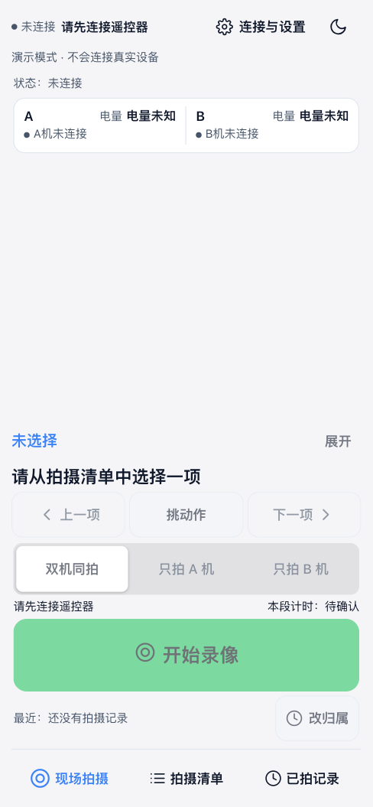

**截图条件：** 390×844，浅色；只创建一个隔离 app 实例，模拟客户端尚未连接。

**如何理解：** 手机页面已加载，但还没连接遥控器；设备信息未知，START 和动作选择处于禁用态。

**开放评审问题：** 连接入口同时承担设置入口。用户能否立即看懂“页面已打开”和“设备可用”的区别？

### 02-ready-light｜连接后待机首页

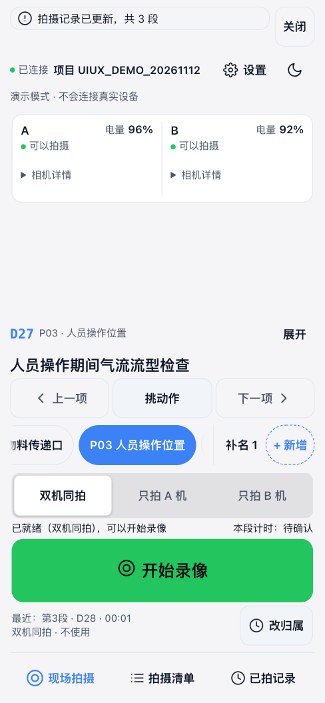

**截图条件：** 390×844；A/B 模拟就绪，D27/P03 已确认；历史记录来自说明用事件。

**如何理解：** A/B、电量、状态在上方轻分组；中间有明显留白；动作/点位、选机、录停与最近一段靠下。

**开放评审问题：** 评估信息边界、留白与操作稳定性的取舍，不预设必须扁平化或恢复多层卡片。

### 03-camera-details｜首页展开相机详情

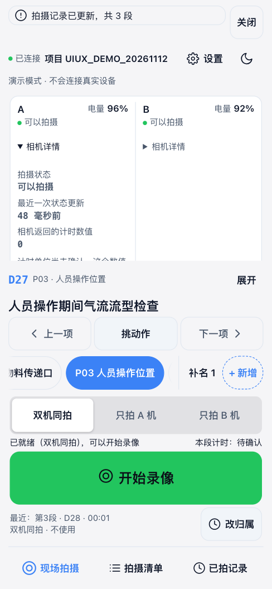

**截图条件：** 390×844；原生详情控件展开 A 机，观察区内部滚动。

**如何理解：** 展开 A 机后增加拍摄状态、新鲜度、原始计时数值和指示灯说明；观察区存在内部纵向滚动。

**开放评审问题：** 相机信息是否易于比较？可滚动区域与被截在下方的内容是否足够容易发现？

### 04-shoot-details-sheet｜当前动作全文与点位补名入口

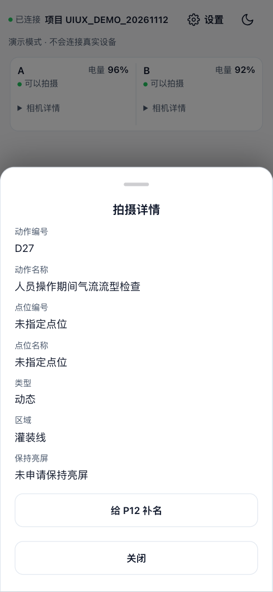

**截图条件：** 390×844；等待原生详情抽屉入场动画完成，当前 D27/P01，保留未命名历史点位入口。

**如何理解：** “展开”打开完整动作/点位信息、类型/区域、保活说明及未命名点位的补名入口。

**开放评审问题：** 摘要与详情的职责是否清楚？“展开”“补名”等词和入口是否容易找到？

### 05-settings-device-details｜全局设置及设备详情

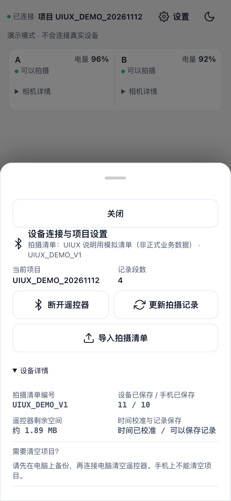

**截图条件：** 390×844；等待设置抽屉入场完成，设备详情已展开。

**如何理解：** 全局原生抽屉集中连接、更新拍摄记录、导入清单；设备详情显示清单身份、同步进度和存储信息。

**开放评审问题：** 首次使用、已连接后的低频操作及诊断信息是否混在同一层级？11/10 这类计数应如何解释？

### 06-action-list｜拍摄清单：搜索与三组筛选

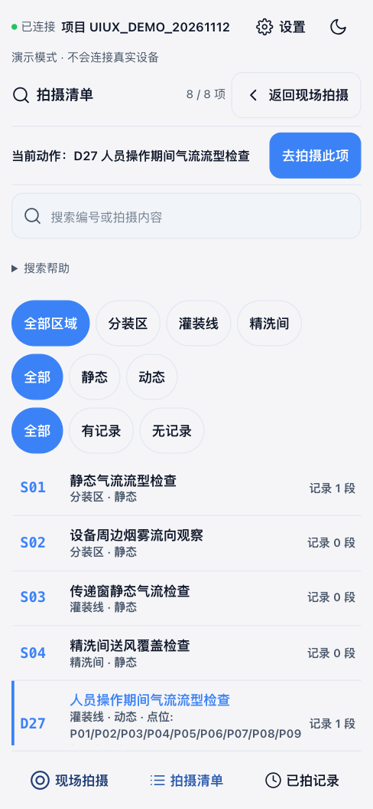

**截图条件：** 390×844；8 个模拟动作，区域/类型/有无记录分别筛选。

**如何理解：** 顶部当前选择/返回入口，下方搜索、区域、类型、有无记录三组筛选，再下面才是动作列表。

**开放评审问题：** 控制区占用高度与列表浏览效率是否合理？先确认动作、再返回拍摄的路径是否清楚？

### 07-action-list-filtered｜清单搜索与筛选组合

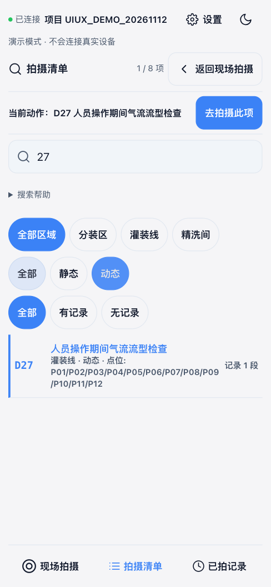

**截图条件：** 390×844；输入 27 并选择动态；动作确认与返回拍摄为不同操作。

**如何理解：** 输入 27 并选动态，列表缩为 D27；筛选和当前设备选择不是同一个状态。

**开放评审问题：** 用户能否区分“筛出来”“当前选中”和“准备拍摄”，并看懂清除/恢复路径？

### 08-records｜已拍记录、结果与更正操作

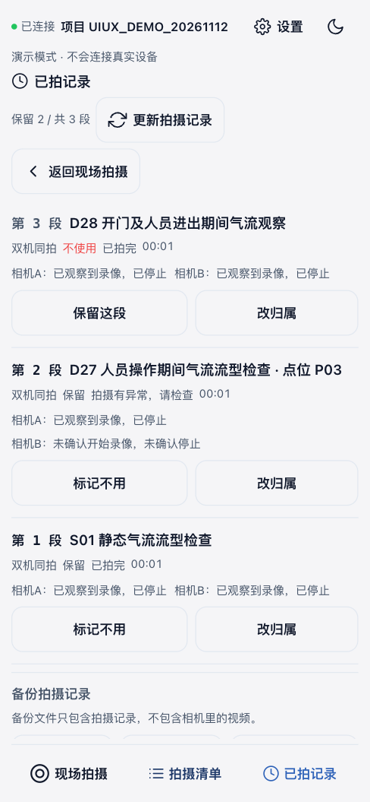

**截图条件：** 390×844；模拟正常段、异常段和标记不用段，列表需纵向滚动。

**如何理解：** 记录按段展示动作/点位、双机参与、结果、控制器区间计时；每段有不用/保留与改归属。

**开放评审问题：** 异常原因是否比原始术语更容易理解？记录数会不会被误认为有效成片数？

### 09-reassign-editor｜已结束片段的归属更正面板

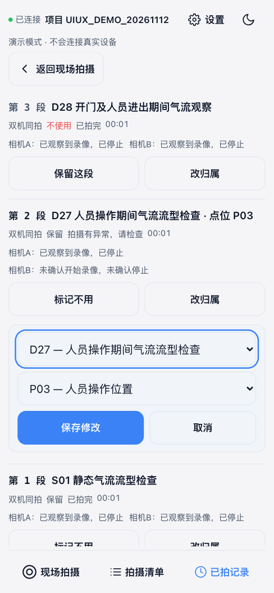

**截图条件：** 390×844；打开第 2 段模拟记录更正面板，未提交修改。

**如何理解：** 第 2 段下方内联展开动作和点位选择器，保存修改/取消位于同一局部面板。

**开放评审问题：** 编辑对象与当前设备选择能否区分？长列表中是否容易编辑错段或丢失上下文？

### 10-records-backup｜记录页底部的备份与导出

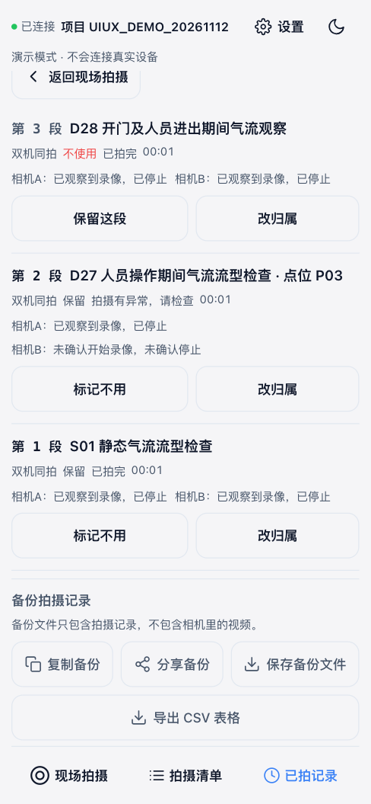

**截图条件：** 390×844；记录页底部四个导出/分享入口，文件不包含相机视频。

**如何理解：** 滚动到记录页底部才能完整看到复制、分享、保存文件和 CSV 四个入口；不包含相机视频。

**开放评审问题：** 入口是否重复、优先级是否清晰？用户是否能分辨设备主记录与手机本地副本？

### 11-add-point-sheet｜新增点位输入抽屉

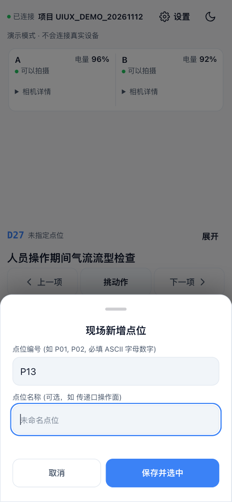

**截图条件：** 390×844；等待入场完成的原生表单，未保存；没有模拟 iOS 原生软键盘。

**如何理解：** 新增点位为原生模态输入表单；编号和名称分开，保存后还涉及设备选择确认。

**开放评审问题：** 软键盘、校验、取消和焦点恢复需要怎么验收？截图不能证明实际 iOS 键盘可达性。

### 12a-starting-dark｜开始请求已收到、尚待相机确认

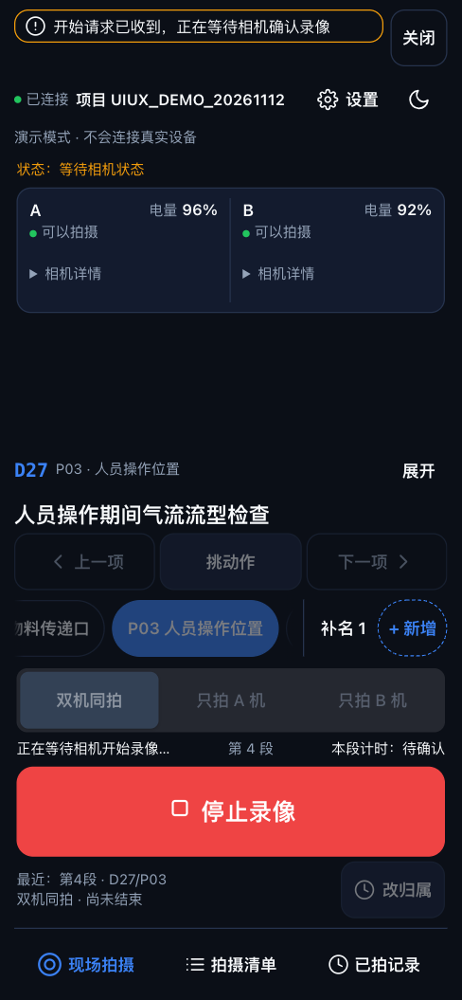

**截图条件：** 390×844，深色；START 已发出，但 mock 尚未提供相机录像通知，主按钮已可停止/取消。

**如何理解：** START 已发出，界面等待相机确认；主操作已经是停止/取消，不应宣称已经录像。

**开放评审问题：** 请求已接收与相机确实录像之间，状态差异是否足够明显，等待阶段能否安全退出？

### 12-recording-dark｜录像中的现场页

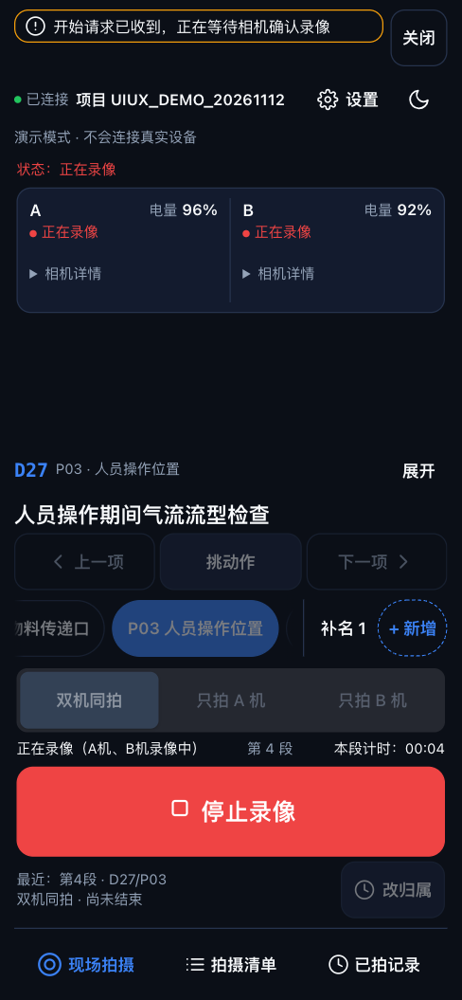

**截图条件：** 390×844，深色；演示 START 后由 mock client 提供相机录像确认，不是真机证据。

**如何理解：** A/B 与主观察行均已显示录像，主按钮为红色停止；当前动作不可随意切换。

**开放评审问题：** 截图顶部仍可看到“正在等待相机确认录像”的提示；请独立判断该提示的生命周期与主状态是否产生冲突。

### 13-recording-list-dark｜录像中跨页查看清单

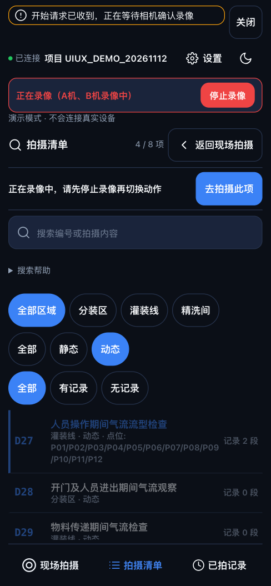

**截图条件：** 390×844，深色；跨页状态条和直接停止入口，录像状态来自模拟通知。

**如何理解：** 切到清单页后顶部保留录像状态和直接 STOP；选择项因拍摄阶段而禁用。

**开放评审问题：** 跨页安全停止是否醒目？顶部多个信息条和被禁用列表是否增加认知负担？

### 14-stopping-dark｜停止请求等待中

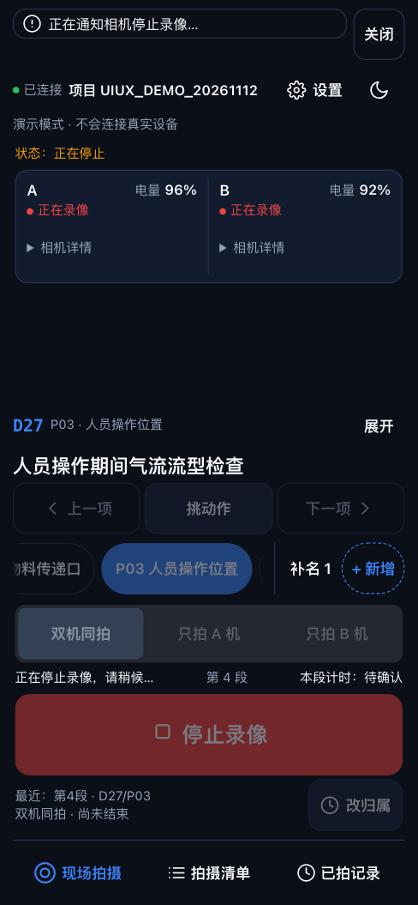

**截图条件：** 390×844，深色；在 mock 传输边界暂挂 STOP 回复，未改写 app.state。

**如何理解：** STOP 回复在模拟传输边界暂挂；页面显示正在停止，主按钮暂时禁用。

**开放评审问题：** 等待停止时，用户是否理解“命令在处理”不等于“相机已停止”，也不会误以为页面卡死？

### 15-template-mismatch-small｜清单不匹配：修复后的门禁表达

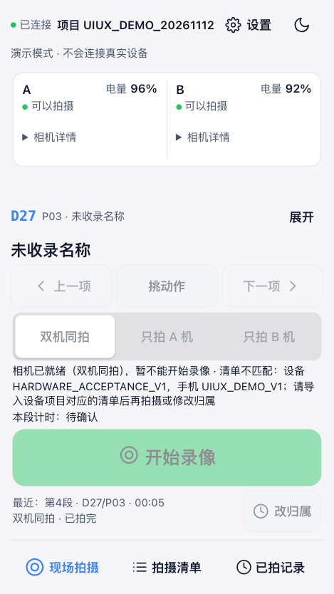

**截图条件：** 375×667；模拟设备清单 ID 改为 HARDWARE_ACCEPTANCE_V1，手机仍为说明清单，START 禁用。

**如何理解：** 模拟设备模板与手机模板不一致；相机仍可就绪，但新 START 被禁用，当前业务名称不借用其他模板。

**开放评审问题：** 这是 v8 修复后的表达。请评估解释长度、禁用原因和恢复路径是否清楚，不要通过绕过身份门禁解决。

### 16-small-ready｜较小屏幕的正常待机布局

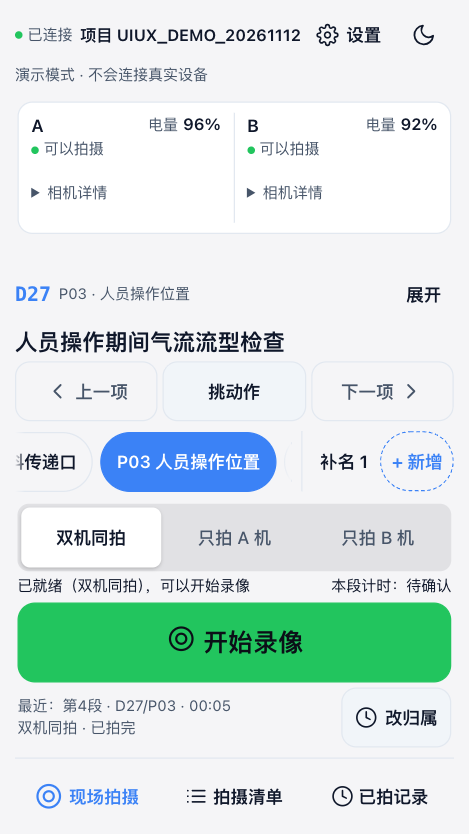

**截图条件：** 375×667；模拟 STOP 已结束并收到新鲜待机通知，恢复匹配。

**如何理解：** 375×667 下，匹配清单和新鲜相机状态已恢复，开始按钮可用。

**开放评审问题：** 与 390×844 对照，哪些内容被压缩、换行或需要滚动？注意点位横轨与按钮之间的空间。

### 17-storage-error｜手机记录未同步的持续错误摘要

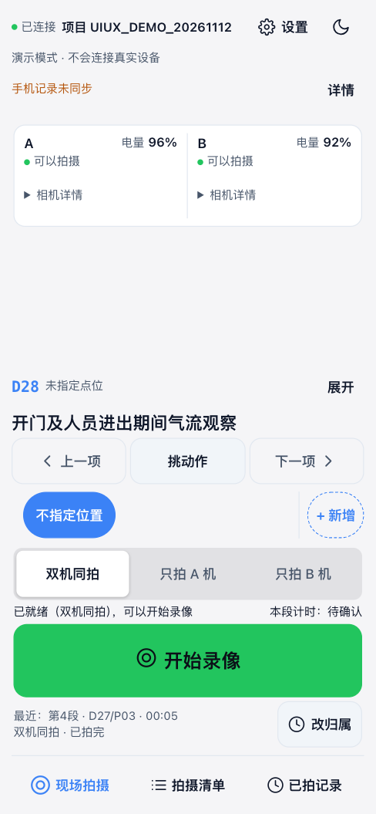

**截图条件：** 390×844；在独立内存 storage 写入边界注入 QuotaExceededError，再手动更新模拟记录。

**如何理解：** 本机内存存储被模拟为写入失败；顶部保留“手机记录未同步”与详情，设备拍摄准入并非自动失败。

**开放评审问题：** 用户能否区分设备记录成功和手机副本未同步？“可以拍”与“记录未同步”是否需要更明确解释？

### 18-storage-error-details｜存储错误详情抽屉

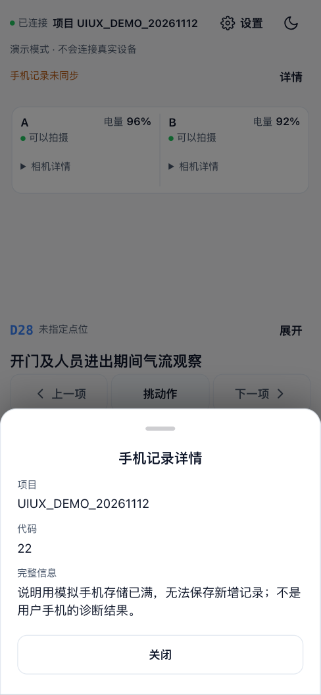

**截图条件：** 390×844；等待抽屉入场完成，完整错误来自隔离模拟故障，不是用户真机诊断结果。

**如何理解：** 原生详情抽屉展示项目、错误码与完整模拟错误；底下持续错误摘要不被关闭动作清除。

**开放评审问题：** 重要信息是否在抽屉中易读？错误码、原始文本、用户可执行恢复动作的层级如何安排？

### 19-desktop-three-columns｜桌面三列工作台

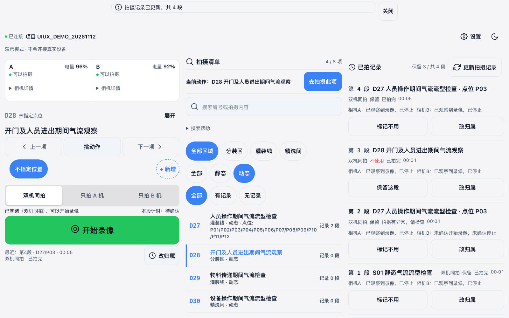

**截图条件：** 1280×800；同一套控件同时呈现现场、清单和记录。

**如何理解：** 1280×800 使用同一组控件，同时展示现场、清单和记录；底部导航在桌面布局隐藏。

**开放评审问题：** 三列的视觉主次、操作归属、列表密度与移动端心智是否一致？

### 20-large-text-pressure｜小屏大字压力下的首屏

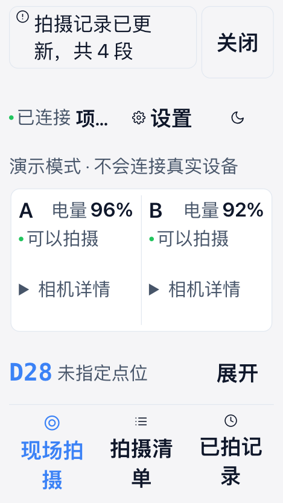

**截图条件：** 375×667；浏览器根字号 200%，现场页整区滚动；不是 iOS Dynamic Type 实机证明。

**如何理解：** 375×667，浏览器根字号 200%（32px）；现场视图进入整区滚动，截图为该状态首屏而非滚动全貌。

**开放评审问题：** 本图不保证所有操作首屏可见。请从源码核对可滚动到达、导航换行、反馈占高与焦点可达性。
